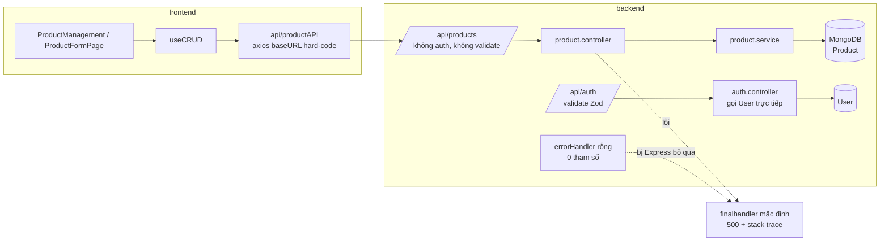

# 00 — Tổng quan review

- Ngày review: 2026-10-15 · Chế độ: **Đầy đủ** (lần đầu, chưa có báo cáo cũ)
- Phạm vi: toàn bộ `frontend/`, `backend/` và cấu hình gốc tại commit `5e00840` (cộng thay đổi chưa commit ở `package.json` gốc: script `dev` dùng `concurrently`)
- Bối cảnh: repo học fullstack theo buổi (Day 04 → Day 05 + React Hook Form). Học viên mới bắt đầu. Stack do khoá học quy định: React + Vite, Express, MongoDB.
- Thang điểm: chấm theo chuẩn của một sản phẩm hoàn chỉnh. Nhiều hạn chế bên dưới là **phần chưa học tới**, nên đọc điểm kèm theo tiến độ (xem `03-NHAN-XET-HOC-VIEN.md`).

## 1. Stack nhận diện được

| Hạng mục | Hiện trạng | Bằng chứng |
|---|---|---|
| Ngôn ngữ | JavaScript cả hai phía, không TypeScript, không JSDoc | không có `tsconfig.json` |
| Module system | ESM cả hai phía (`"type": "module"`), không còn `require` | `backend/package.json`, `frontend/package.json`; grep `require(` → 0 kết quả |
| Backend | Express 5.2.1 | `backend/node_modules/express/package.json` |
| Database & ODM | **MongoDB + Mongoose 9.10.2** (chuẩn áp dụng: `database-mongodb.md`) | dependency `mongoose`, `backend/src/config/db.config.js` |
| Migration | Không có | không có `migrations/`, `migrate-mongo-config.*` |
| Frontend | React 19 + Vite 7 (SPA, `@vitejs/plugin-react-swc`) — nhánh A | `frontend/vite.config.js` |
| Router | React Router 7.18 Data Router (`createBrowserRouter`) | `frontend/src/routes/AppRoute.jsx:19` |
| State & data | `useState` + `useEffect` trong custom hook `useCRUD`; không Zustand/TanStack Query | `frontend/src/hooks/useCRUD.js` |
| Form & validation | FE: react-hook-form + Zod 4 (form sản phẩm). BE: Zod 4 qua middleware `validate` (chỉ auth) | `ProductFormPage.jsx`, `backend/src/shared/middlewares/validate.js` |
| Cấu trúc repo | Monorepo nhẹ: 2 app độc lập, `package.json` gốc chỉ chứa script (`npm --prefix`, `concurrently`), không workspaces (quyết định đã chốt) | `package.json` gốc |
| Test | Không có | không có file `*.test.*`/`*.spec.*`, không có script `test` |
| Hạ tầng | Không có Docker, CI, deploy | — |

## 2. Hệ thống và luồng dữ liệu

- **Actor**: khách (xem trang client), admin (quản lý sản phẩm), thành viên (đăng ký/đăng nhập — mới có API).
- **Luồng chạy end-to-end được**: admin CRUD sản phẩm (`/admin/san-pham` → `productAPI` → `/api/products` → `Product`).
- **Luồng có ở BE, chưa có ở FE**: đăng ký, đăng nhập (đăng nhập hiện đang lỗi, xem ERR-01).

Các điểm lỗi đơn (single point of failure) chính:

- `errorHandler` không hoạt động, nên mọi lỗi đều trả HTML kèm stack trace, còn route không tồn tại thì bị treo (ERR-02).
- Mất kết nối DB không làm app dừng, request bị treo (ERR-03).

## 3. Điểm mạnh

- **Cấu trúc backend theo module** đúng hướng: `modules/<tên>/{route,controller,service,model,schema}`, có `shared/` và `routes/index.js` mount tập trung.
- **ESM nhất quán**, dùng Express 5 (không cần try/catch trong controller).
- **Middleware `validate({ body, query, params })`** viết gọn, đúng chuẩn, gắn ở tầng route (`auth.route.js`).
- Mongoose schema có `required`, `enum`, `default`, dùng chung `optionsSchema` (`timestamps`, bỏ `__v`).
- **Frontend tách layouts/pages theo vai trò** (admin/client/common), dùng Data Router, route admin tách file riêng, có `ProtectedRoute` theo role.
- **Tầng API phía FE** tách theo resource. Hook `useCRUD(apiService)` tái sử dụng được và có toast thông báo.
- Form sản phẩm dùng react-hook-form + Zod, hiển thị lỗi theo từng field.
- `.env` chưa từng bị commit (đã kiểm tra `git log --all`).

## 4. Hạn chế chính

- Bảo mật: route ghi dữ liệu sản phẩm mở hoàn toàn (SEC-01), tất cả user dùng chung một salt bcrypt (SEC-02).
- Lỗi runtime: đăng nhập luôn trả 500 (ERR-01), xử lý lỗi tập trung không hoạt động (ERR-02).
- Route sản phẩm không có validate nào (VAL-01).
- Không có test, README hay API docs. Lint FE không pass.

## 5. Thống kê vấn đề

| Mức độ | `[NGUYÊN TẮC]` | `[CHUẨN]` | Tổng |
|---|---|---|---|
| Critical | 1 | 0 | 1 |
| High | 4 | 0 | 4 |
| Medium | 14 | 2 | 16 |
| Low | 3 | 3 | 6 |
| **Tổng** | **22** | **5** | **27** |

Chi tiết: `01-VAN-DE-VA-RUI-RO.md`. Kiến trúc đích và lộ trình: `02-KIEN-TRUC-DE-XUAT.md`.

## 6. Điểm tổng

**4,75 / 10 — Chưa đạt** (46,3/100). Có 1 lỗi Critical nên nhóm Bảo mật bị giới hạn trần 4/10. Bảng điểm chi tiết ở `03-NHAN-XET-HOC-VIEN.md`.

Ước tính: chỉ cần xử lý xong P0 và các lỗi High (SEC-01, SEC-02, ERR-01, ERR-02, VAL-01) cùng vài smoke test là điểm có thể lên khoảng **6,5 (Khá)**, chưa cần đổi kiến trúc.

## 7. Phần chưa thể xác minh

- Chưa chạy server thật (cần MongoDB và secret thật). Các kết luận về hành vi runtime (ERR-01, ERR-02) dựa trên đọc code dự án và source thư viện trong `node_modules`, chưa gọi request thực tế.
- Chưa rõ phần nào do học viên tự viết, phần nào là code demo của giảng viên: mọi commit đều của tác giả `hoangnm-ndm`.
- Không có đề bài chi tiết của từng buổi, nên nhóm "Hoàn thành nghiệp vụ" được chấm theo phạm vi suy ra từ commit message và code.
- Trong lúc review xuất hiện `backend/prisma/seed.js` (rỗng, chưa commit), nhưng không có `schema.prisma` hay dependency Prisma. Chưa rõ có ý định chuyển sang Prisma/PostgreSQL không. Review vẫn áp dụng chuẩn MongoDB. Nếu chỉ cần file seed cho Mongo thì nên đặt ở `backend/scripts/seed.js` (`database-mongodb.md` mục 2), tránh gây nhầm là dự án dùng Prisma.
