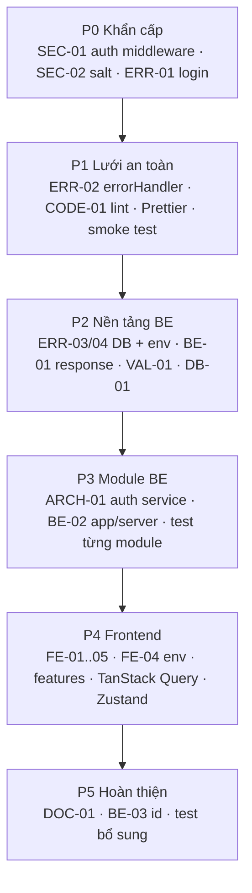

# 02 — Kiến trúc đề xuất và lộ trình

Nguyên tắc: **không viết lại**, giữ cấu trúc đã đúng, mỗi bước nhỏ và chạy được ngay. Giữ JavaScript, vì dự án nhỏ nên JS chấp nhận được. Nên thêm JSDoc cho `shared/utils`. Chuyển sang TypeScript là bước của khoá sau.

## 1. Backend — cây thư mục đích

Áp dụng cho các module thật của dự án: `auth`, `user`, `product` (sau này thêm `category`, vì FE đã có `categoryAPI`). Database: MongoDB + Mongoose, nên model nằm trong module.

```text
backend/
├── src/
│   ├── app.js                      # MỚI (BE-02): express app, cors theo env, json limit, /api, notFound, errorHandler
│   ├── server.js                   # MỚI (thay index.js): validate env → await connectDB → listen → graceful shutdown
│   ├── config/
│   │   ├── env.config.js           # SỬA (ERR-04): validate bằng Zod, chọn file theo NODE_ENV
│   │   └── db.config.js            # SỬA (ERR-03): trả promise, toJSON toàn cục (BE-03)
│   ├── routes/index.js             # giữ
│   ├── modules/
│   │   ├── auth/
│   │   │   ├── auth.route.js       # giữ
│   │   │   ├── auth.controller.js  # SỬA (ARCH-01): chỉ gọi service + trả response
│   │   │   ├── auth.service.js     # SỬA: register/login/refresh, ném AppError
│   │   │   ├── auth.schema.js      # giữ
│   │   │   └── auth.test.js        # MỚI (TEST-01)
│   │   ├── user/
│   │   │   └── user.model.js       # SỬA (DB-01, SEC-04): lowercase/trim email, select:false password
│   │   └── product/
│   │       ├── product.route.js    # SỬA (SEC-01, VAL-01): checkAuthentication + checkRoles + validate
│   │       ├── product.controller.js
│   │       ├── product.service.js  # SỬA (DB-01): runValidators, ném 404
│   │       ├── product.model.js
│   │       ├── product.schema.js   # VIẾT (VAL-01): create/update/idParam
│   │       └── product.test.js     # MỚI
│   └── shared/
│       ├── constants/optionsSchema.js   # đổi tên (CODE-03)
│       ├── errors/AppError.js           # MỚI: class AppError(statusCode, code, message, details)
│       ├── middlewares/
│       │   ├── auth.js                  # VIẾT (SEC-01)
│       │   ├── validate.js              # giữ
│       │   ├── errorHandler.js          # VIẾT (ERR-02): map Zod/Cast/Validation/11000/JWT
│       │   └── notFound.js              # MỚI
│       └── utils/
│           ├── jwt.js                   # SỬA (ERR-01): payload object, verify*
│           ├── password.js              # SỬA (SEC-02): bcrypt.hash/compare async
│           └── response.js              # MỚI (BE-01): sendSuccess
├── eslint.config.js                # MỚI (CODE-01)
├── .env.example                    # giữ, cập nhật khi thêm biến (NODE_ENV)
└── package.json                    # thêm start, lint, test
```

Chưa cần (YAGNI): `lib/` (chưa có mailer, logger, storage), `migrations/` (xem lộ trình "khi tăng trưởng"), `/api/v1` (chỉ cần khi có client cũ phải giữ tương thích).

Giữ `src/config/` thay vì chuyển sang `shared/config/` như mẫu chuẩn. Vị trí hiện tại rõ ràng, chuyển chỉ tốn công.

## 2. Frontend — cây thư mục đích

Feature thật: `products`, `auth` (sau này `categories`, `users`).

```text
frontend/
├── src/
│   ├── main.jsx
│   ├── app/
│   │   ├── App.jsx                       # ToastContainer (+ QueryClientProvider ở P4)
│   │   └── router/
│   │       ├── index.jsx                 # createBrowserRouter ở cấp module (FE-01)
│   │       ├── client.routes.jsx
│   │       ├── admin.routes.jsx          # từ routes/adminRoutes.jsx
│   │       ├── auth.routes.jsx           # register, login, forgot-password
│   │       └── guards/ProtectedRoute.jsx # đọc user từ auth store thay vì hard-code
│   ├── layouts/                          # giữ: admin/, client/, common/ (AuthLayout)
│   ├── pages/                            # giữ, nhưng mỏng: chỉ ghép component từ features
│   │   ├── admin/ (DashboardPage, product/ProductManagementPage, product/ProductFormPage, SettingsPage)
│   │   ├── client/ (HomePage, ProductPage, AboutPage)
│   │   └── common/ (LoginPage, RegisterPage, ForgotPasswordPage, NotFoundPage)
│   ├── features/
│   │   ├── products/
│   │   │   ├── api.js                    # từ frontend/api/productAPI.js
│   │   │   ├── hooks.js                  # useProducts/useProduct/useCreateProduct... (TanStack Query, P4)
│   │   │   ├── schemas.js                # từ shared/validation/productSchema.js
│   │   │   └── components/ (ProductTable, ProductForm)
│   │   └── auth/
│   │       ├── api.js, schemas.js
│   │       └── store.js                  # Zustand: user, accessToken (P4)
│   └── shared/
│       ├── lib/http.js                   # từ frontend/api/index.js, baseURL = VITE_API_URL (FE-04)
│       ├── hooks/                        # hook dùng chung không thuộc feature
│       ├── components/ui/                # Button (nếu dùng)
│       └── constants/ (roles.js, routes.js)
├── .env.example                          # VITE_API_URL=
└── eslint.config.js
```

Điểm thay đổi quan trọng nhất: đưa `frontend/api/` vào `src/`. Hiện tại import phải đi lên 4 cấp (`../../../../api/productAPI`), và thư mục này nằm ngoài vùng mà Vite/ESLint ngầm coi là source.

## 3. Lộ trình chuyển đổi



### Làm ngay (P0 — trước khi học tiếp phần mới)

1. **ERR-01**: sửa `signRefreshToken` ký `{ userId }`. Một dòng, giúp login chạy lại.
2. **SEC-02**: `bcrypt.hash(pw, 10)` / `bcrypt.compare`, nhớ `await`.
3. **SEC-01**: viết `verifyAccessToken`, `checkAuthentication`, `checkRoles`, gắn vào route ghi sản phẩm. Kiểm tra bằng Postman: không token → 401, token member → 403, token admin → 200.

### Lưới an toàn (P1)

4. **ERR-02**: `notFound` + `errorHandler(err, req, res, next)`. Kiểm tra: `GET /api/abc` → 404 JSON, `GET /api/products/123` → 400 JSON, không còn stack trace.
5. **CODE-01**: lint FE về 0 error; thêm `.prettierrc`, `.editorconfig`, `.nvmrc` (OPS-01).
6. **TEST-01 (bước 1)**: tách `app.js` (BE-02) rồi viết 2–3 smoke test Supertest cho register/login.

### Trước khi deploy (P2–P3)

7. **ERR-03, ERR-04**: kết nối DB fail fast, validate env.
8. **VAL-01**: `product.schema.js` + `validate` + `req.validated`.
9. **BE-01**: helper response và định dạng lỗi thống nhất. FE `useCRUD` đọc theo định dạng mới.
10. **ARCH-01**: chuyển nghiệp vụ auth vào service.
11. **DB-01**: email `lowercase/trim`, `runValidators`, `returnDocument`.
12. **SEC-03**: CORS theo env, rate limit `/auth`, helmet.
13. **FE-04**: `VITE_API_URL`.

### Phiên bản sau (P4–P5)

14. **FE-01, FE-02, FE-03, FE-05**: sửa router, luồng form, import, a11y.
15. **ARCH-02**: đưa `api/` vào `src/features/*`; thay `useCRUD` bằng TanStack Query (bài sau); Zustand cho phiên đăng nhập, `ProtectedRoute` đọc từ store.
16. **BE-03**: chuẩn hoá `id`, sửa FE trong cùng commit.
17. **DOC-01**: README + `docs/`.

### Khi tăng trưởng

- **DB-02**: migrate-mongo cho index; phân trang `getAll`; giá lưu số nguyên.
- `/api/v1`, `/health`, logger (pino), CI chạy lint + test.

### KHÔNG nên làm lúc này

- Chuyển sang npm workspaces / `apps/`: đã chốt giữ monorepo nhẹ (xem `CHECKLIST.md`). Chỉ cân nhắc lại sau khi sửa FE-03.
- `packages/shared` dùng chung schema giữa FE/BE: chuẩn khoá học không khuyến nghị.
- Chuyển toàn bộ sang TypeScript ngay: tốn công, lệch tiến trình bài học.
- Docker/CI đầy đủ, microservice, message queue: quy mô hiện tại chưa cần (YAGNI).
